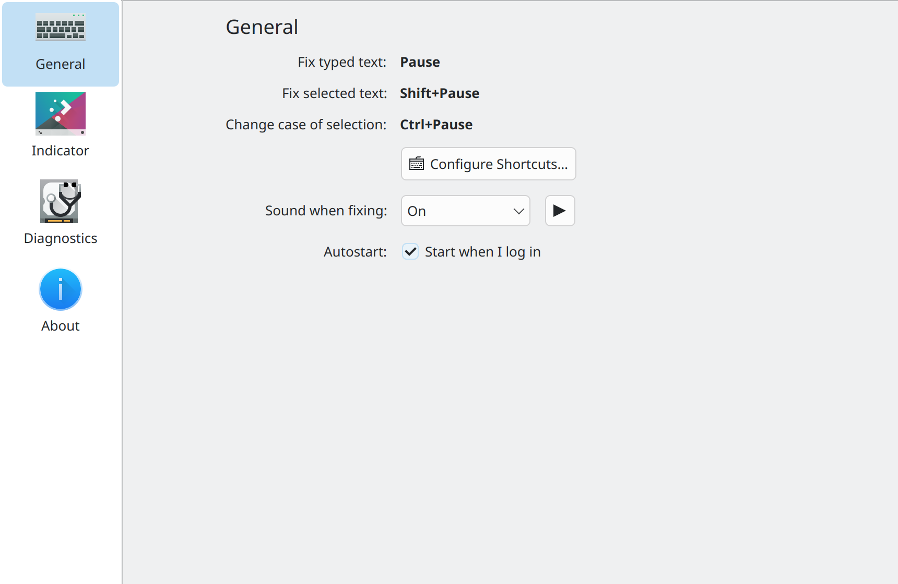
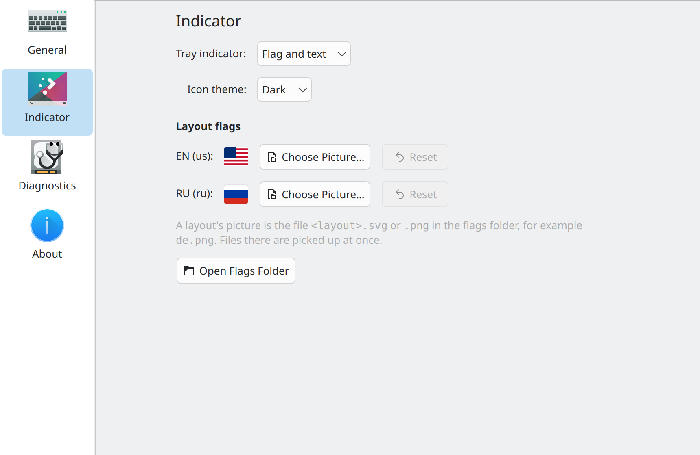
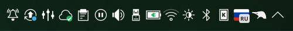

<p align="center"></p>

# ntrcn

[](README.md)
[](README.ru.md)

Fix text typed in the wrong keyboard layout on KDE Plasma 6 (Wayland).

Typed `ghbdtn vbh` while the English layout was active instead of the Russian one?
Press <kbd>Pause</kbd> and it becomes `привет мир`, with the layout switched so you can keep
typing. Works in any application, terminals included, and with any number of layouts.

## Background

I had long missed a layout switcher on Linux. I touch-type with ten fingers (thanks to
V. V. Shakhidzhanyan and his [Solo on the Keyboard](https://ergosolo.ru)), but now and then
I type a phrase quickly and only then notice I forgot to switch the layout.

On X11 there was [xneur](https://github.com/AndrewCrewKuznetsov/xneur-devel), but I moved to
Wayland long ago, and found nothing decent there. I wrote a bash script of a few lines: on
<kbd>Pause</kbd> it used `wl-clipboard` and `ydotool` to copy the text, convert it and paste
it back. I used it for years, but it is a crude hack and works poorly.

What also annoys me is that KDE Plasma does not let you put your own flag picture on the
layout indicator. In KDE 4 it was enough to drop a `flag.png` into a folder in your home
directory, in Plasma 5 you had to replace system files, and in Plasma 6 the flags are drawn
from the emoji font, with nothing to replace. Xfce still allows it, but that is no reason to
switch to it.

So I decided to kill two birds with one stone and finally make a proper layout switcher,
remembering Punto Switcher, which I used back before Yandex bought it.

## Features

- Fixes the last typed words or the selected text and switches the layout.
- Hunspell dictionaries tell where the mistyped part starts, so words typed correctly before
  it stay as they are (`hello ghbdtn` → `hello привет`).
- Any number of layouts; with three or more, the dictionaries pick the right one.
- Changing the case of the selected text.
- Tray indicator: flag, layout name, both, the app icon, or nothing. Flags can use your own
  pictures.
- Optional sound, autostart, a diagnostics page.
- Interface in English and Russian; translations are welcome (see
  [CONTRIBUTING.md](CONTRIBUTING.md)).

## Screenshots

 



## Requirements

- KDE Plasma 6 on Wayland
- Python 3.10+, PySide6, `python3-evdev`, `python3-dbus`
- `wl-clipboard`, `libxkbcommon`, `libhunspell`
- Hunspell dictionaries for your layouts (optional, see [Dictionaries](#dictionaries))

## Installation

### Debian / Ubuntu / KDE neon package

For Debian 13+, Ubuntu 25.10+ and KDE neon. Ubuntu 24.04 ships Plasma 5, so there it works
only with the KDE neon repository added.

```bash
wget https://github.com/DayDve/ntrcn/releases/download/v0.1.0/ntrcn_0.1.0_all.deb
sudo apt install ./ntrcn_0.1.0_all.deb
sudo usermod -aG input $USER
```

Log out and back in: membership in the `input` group (to read keyboards) and access to
`/dev/uinput` (granted by the bundled udev rule) take effect in a new session.

### From my APT repository

ntrcn is also in my APT repository [apt.smbit.pro](https://apt.smbit.pro), built for
Ubuntu 24.04 (noble): KDE neon, or Ubuntu 24.04 with the KDE neon repository. Updates then
come with the rest of the system.

```bash
curl -sL https://apt.smbit.pro | bash
sudo apt install ntrcn
sudo usermod -aG input $USER
```

Then log out and back in, as above.

### From source

```bash
sudo apt install python3-evdev python3-dbus python3-pyside6.qtwidgets python3-pyside6.qtsvg \
    python3-pyside6.qtnetwork wl-clipboard libxkbcommon0 libhunspell-1.7-0
sudo usermod -aG input $USER
sudo install -m 644 src/ntrcn/70-ntrcn-uinput.rules /etc/udev/rules.d/
sudo udevadm control --reload && sudo udevadm trigger /dev/uinput
make install-user   # ~/.local/bin/ntrcn, menu entry, autostart
```

## Usage

| Key | Action |
| --- | --- |
| <kbd>Pause</kbd> | Retype the mistyped text before the cursor |
| <kbd>Pause</kbd> again | Same text in the next layout (with two layouts, undo) |
| <kbd>Shift</kbd>+<kbd>Pause</kbd> | Retype the selection |
| <kbd>Ctrl</kbd>+<kbd>Pause</kbd> | Change the case of the selection |

These are the default shortcuts; change them in System Settings → Keyboard → Shortcuts →
ntrcn, like those of any KDE application. Left-click the tray indicator to switch layouts, or
scroll over it; its menu opens the settings.

## Configuration

Settings are in the tray menu. With the indicator turned off, start `ntrcn` again from the
application menu, or run `ntrcn --settings`. Changes apply immediately and are stored in
`~/.config/ntrcn/config.json`.

Custom flag pictures go to `~/.config/ntrcn/flags/<layout>.svg` or `.png` (for example
`de.png`) and are picked up right away.

Layout names in the tooltip and the menu come translated from xkeyboard-config. On Ubuntu and
KDE neon the translations are part of the language pack, for example
`sudo apt install language-pack-ru-base`; Debian ships them in `xkb-data`. Restart ntrcn after
installing it; Plasma's own layout pop-up picks them up after you log in again.

## Dictionaries

The language of each layout comes from the XKB registry; dictionaries are looked up in
`/usr/share/hunspell`, `/usr/share/myspell` and `~/.local/share/hunspell`. Without a
dictionary for a layout, only the last word is retyped.

The diagnostics page in the settings lists missing dictionaries with the install command for
your distribution and can download them from the
[LibreOffice dictionaries](https://github.com/LibreOffice/dictionaries) into
`~/.local/share/hunspell`.

## How it works

ntrcn reads key presses from all keyboards through evdev without grabbing them and remembers
which physical keys were pressed in which layout. On <kbd>Pause</kbd> it switches the layout
through Plasma's D-Bus interface, erases the text with Backspace and presses the same keys
again on a virtual keyboard (`/dev/uinput`). The selection is read from the primary selection
and retyped with keys looked up in the XKB keymaps.

## Privacy

ntrcn sees every key press, so:

- typed keys stay in memory only, at most the last 256, cleared on Enter, clicks, arrows and
  shortcuts;
- nothing typed is written to disk or to logs, `--debug` included;
- the only network access is the dictionary download, on request.

It cannot tell a password field from any other field, and membership in the `input` group
lets any of your programs read the keyboard.

## Limitations

- Plasma 6 only: layouts are switched through its D-Bus interface.
- Autocompletion and pasting are not seen as typing; select the text and use
  <kbd>Shift</kbd>+<kbd>Pause</kbd> instead.
- Dictionaries do not know names and jargon; such words at the start of the mistyped part are
  left as they are.
- With aggressive audio power saving (`snd_hda_intel` `power_save`), the start of the sound may
  be cut off.

## Development

```bash
python3 -m venv --system-site-packages .venv && .venv/bin/pip install pytest ruff mypy
make check               # ruff, mypy, pytest
make run                 # run from the source tree with debug logging
make e2e                 # live test on the current desktop
make deb                 # build the .deb in a Debian container (docker), into dist/
make deb-check deb-test  # check its contents and install it into clean containers
```

See [CONTRIBUTING.md](CONTRIBUTING.md) for the development rules.

## License

MIT, see [LICENSE](LICENSE). The flags are from [vlags](https://vlags.com), CC BY-SA 4.0;
the keyboard sound is mixed from
[Keyboard Soundpack #1](https://opengameart.org/content/keyboard-soundpack-1-typing-and-single-keystrokes),
CC0.

Why am I doing this? Because I can.
